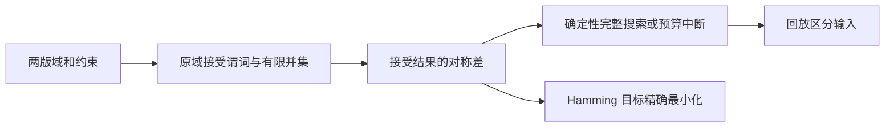

# kiln · 规则变更回归与最小反例

[](https://github.com/DWS-ai-nb/kiln/actions/workflows/ci.yml)

**比较两版有限域算术规则，找出哪些输入从接受变成拒绝、哪些从拒绝变成接受，再求离指定基线改动字段最少的反例。** Pure MoonBit finite-domain rule regression and exact minimum-field change witnesses.

例如订单原价 50、会员折扣 10、优惠券 0 的配置在两版都合法。新版增加“应付金额不能为负”后，kiln 找到只改变一个字段的区分输入：原价变为 0，旧版接受、新版因 `nonnegative-charge` 拒绝。见证可在两版原始模型上重新验证。

项目面向需要在 CI 中审查**跨字段业务约束**的开发者。输入是显式有限整数域和算术/布尔 AST，不是任意源程序、JSON Schema 或设备配置的自动翻译。示例都是本项目编写的合成规则，不代表生产采用或实际客户数据。

## 版本与已有基础

0.2.0 是 [原版 kiln 0.1](docs/LEGACY_V0_1.md) 被退回后的实质重建，沿用同一仓库并保留历史。旧版是两类方程的命题工具；新工作是独立的 `model/`、`regression/`、CLI、JS 桥及验证资产，**不调用旧题族、旧有理数或旧组卷代码**。旧版 69 项测试保留，不能计为本次新增测试。逐项回应见 [REVIEW_RESPONSE](docs/REVIEW_RESPONSE.md)。

## 安装与最小使用

固定验证工具链：`moonc 0.10.17+093cb8f9c` 及其匹配 core。源码示例和测试只需 MoonBit；独立对照额外使用 Node.js 22+、Python 3.12，无第三方 Python 包。

```sh
moon add DWS-ai-nb/kiln@0.2.0
```

在调用方的 `moon.pkg` 中导入需要的包：

```text
import {
  "DWS-ai-nb/kiln/model",
  "DWS-ai-nb/kiln/regression",
}
```

可运行的纯库示例：`moon run examples/embedding`，输出 `unique: {"x":6,"y":3}` 和 `verified: true`。不依赖 CLI、Python 或网络求解服务。JS 导出接口在 `api/`。

## 三个完整场景

先从源码构建：

```sh
git clone https://github.com/DWS-ai-nb/kiln.git
cd kiln
moon update
moon build --target js
moon build api --target js
```

| 场景 | 输入与操作 | 可复现的结果 |
| --- | --- | --- |
| 价格规则更新 | `examples/regression/pricing/`；新规则禁止负应付金额 | 4 个旧接受/新拒绝输入；相对所给基线最近反例只改 1 个字段 |
| 配置兼容回归 | `examples/regression/deployment/`；兼容表误删 JS/server 组合，保留存储与持久化条件 | 输出受影响的完整配置及 `runtime-host` 违规，供部署测试回放 |
| 选题配额修改 | `examples/regression/quota/`；基础题配额由 1 改为 2，互斥条件保留 | 找到旧版唯一合法选集被拒绝；新配额无合法选集；可以继续用精确求解和冲突解释定位问题 |

命令与退出码是 CI 接口的一部分。`diff` 检出变化、`closest` 找到变化时退出 **1**；这表示回归门禁检测到差异。**变化不自动等于错误**，预期修复也会改变接受集。

```sh
# 退出 1：确有接受/拒绝变化；输出可回放输入和命名违规
moon run cmd/regression -- diff examples/regression/pricing/before.json examples/regression/pricing/after.json

# 退出 1：找到距离基线最少改动字段的见证，minimal=true 才证明最优
moon run cmd/regression -- closest examples/regression/pricing/before.json examples/regression/pricing/after.json --baseline examples/regression/pricing/baseline.json

# 退出 0：两种算术写法在声明域内等价
moon run cmd/regression -- diff examples/regression/equivalent/before.json examples/regression/equivalent/after.json

# 退出 3：预算耗尽，无见证时 relation=unknown
moon run cmd/regression -- diff examples/regression/pricing/before.json examples/regression/pricing/after.json --budget 0
```

将 `changes[i].assignment` 单独保存为对象 JSON 后，可执行：

```sh
moon run cmd/regression -- replay BEFORE.json AFTER.json --assignment case.json
```

`replay` 只重算两版原始模型的接受与违规，不相信存档中的方向和统计。有效区分见证退出 0，非区分输入退出 1。输入错误退出 2。`closest` 即使已经找到见证，若 `minimal=false`，也不能称为最近反例。

## 模型与语义

```json
{
  "format": "kiln.model/1",
  "variables": [
    {"name": "subtotal", "domain": [0, 50, 100]},
    {"name": "coupon", "domain": [0, 20, 50]}
  ],
  "rules": [
    {"id": "nonnegative", "assert": [">=", ["-", "subtotal", "coupon"], 0]}
  ]
}
```

- 数字是整数常量；字符串是变量引用；运算使用前缀数组。只接受无小数点/指数的整数拼写，避免输入被 Double 舍入或下溢。
- 精确运算 `+ - * / % neg abs`，每个中间结果必须在 ±10^12 内。`/` 向零截断，`%` 随被除数符号。除零/越界为 undefined。
- 规则支持 `== != < <= > >= all any not implies distinct table count`。`indicator` 把布尔规则转成 0/1，服务于精确 Hamming 目标；`holds` 把 undefined 总化为拒绝。
- 普通 `not(undefined)` 仍 undefined。布尔组合允许确定性的真/假分支屏蔽无定义分支；详细规则见 [MODEL_FORMAT](docs/MODEL_FORMAT.md)。
- 对比要求变量名集合一致，声明顺序可以不同；取两版原始域的并集作为比较范围，分别保留各自域的接受约束。目标函数、说明文字和规则 ID 不影响接受语义。



| 结果 | 可以得出的结论 |
| --- | --- |
| `relation=changed` | 至少一个已回放的区分输入，差异确实存在 |
| `relation=equivalent` | 搜索穷尽且零区分输入，只针对报告中的有限域 |
| `relation=unknown` | 没有足够证据；不能按兼容或等价放行 |
| `complete=false` | 列表不是全部变化，常见原因是预算或见证数上限 |
| `minimal=true` | 已穷尽差异空间，Hamming 改动字段数为全局最小；并列解按确定性搜索顺序选取 |

## 通用内核与旧问题的解决

`model/` 提供无题族分派的库 API：`solve`、`classify`、`check_assignment`、`minimize`、`explain`、`negate_rule`。求解采用 MRV、候选前向检查和确定性回溯；最小化是有预算的完整枚举。`explain` 通过逐条删除检查得到相对原域不可再删的冲突子集，不宣称最小基数。

```sh
# 配额与互斥精确建模：唯一选择 B/C/E，成本 12
moon run cmd/model -- solve examples/models/selection.json
moon run cmd/model -- minimize examples/models/selection.json

# 强制选择 A 后无解：返回四条相关冲突规则
moon run cmd/model -- explain examples/models/selection_unsat.json

# 直接对命名不变量求反例；当前 CLI 输出中携带取反后的模型
moon run cmd/model -- counterexample examples/models/pricing.json --rule nonnegative-charge
```

新增非二次题族不需要修改引擎：二元方程组、三次多项式、拉丁方都是数据模型示例。它们只针对显式有限整数域，不声称对实数域作完备代数求解。旧版的启发式“难度分数”仅留在历史 API，新功能输出实际工作计数，不把搜索成本称为学生认知难度。

## 验证与工程边界

```sh
moon check --target all --deny-warn
moon test --target wasm-gc --deny-warn
moon test --target wasm --deny-warn
moon test --target js --deny-warn
moon fmt --check
moon info
moon build --target js
moon build api --target js
python tools/differential.py --cases 1600
python tools/regression_differential.py --cases 800
python tools/check_cli.py
```

- 106 项 MoonBit 测试（原版 69、新增 37），覆盖语义、错误输入、预算、唯一性、精确最小化、双向差异、原域与并集、无定义算术、回放及 100 字段目标。
- 独立 Python 解释器使用任意精度整数后施加范围契约，以固定顺序 DFS、仅在规则相关变量全绑定后求值；不复用 MoonBit 部分求值或 MRV。1607 个完整解集、804 对完整差异集，以及最近见证和预算测试可复现。
- CI 固定编译器与匹配 core，对 wasm-gc/wasm/js/native 强制检查、构建和测试，额外检查 CLI 真实退出码、公共接口漂移、原版跨语言回归。Windows 本机缺 MSVC，native 运行结果以 Linux CI 为准。
- [EVIDENCE](docs/EVIDENCE.md) 给出数据入口和实测范围；工作预算是候选探测次数，**不是秒数、内存或指令总量上限**。

本版适合有界、小规模规则回归，搜索最坏情况指数级；无区间传播、SAT/SMT、BDD、单纯形、并行搜索或生产部署自动化。每模型最多 128 变量、256 命名规则、每域 2048 值、域值合计 16384；AST 总节点/表项 8192、深度 48，比较后的组合模型也要满足限制。默认预算 100000、最多 1000 见证；输入超限返回错误。

## 生态位置与来源

现有 `moonbit_constraint`/MoonPlan 已提供通用有限域求解；CaseWeave 已提供组合测试；EvoWitness 已提供结构契约反例；MoonPolicyProof 已提供网络五元组差异。kiln 不把这些能力宣称为生态空白。这里交付的是**跨字段算术约束版本的接受集差异、原域扩缩和相对配置基线的最少字段反例**，不是它们的完整替代品；[ECOSYSTEM](docs/ECOSYSTEM.md) 如实说明重叠、差异和检索盲区。

源码与合成测试原创，AI 辅助设计、编码、测试和文档，参赛者须理解、审核和维护。没有移植上述项目源码。算法使用常见回溯、MRV、对称差、Hamming 距离和删除式冲突检查，不声称新算法。Apache-2.0；来源与依赖见 [THIRD_PARTY](docs/THIRD_PARTY.md) 和根 `LICENSE`。
